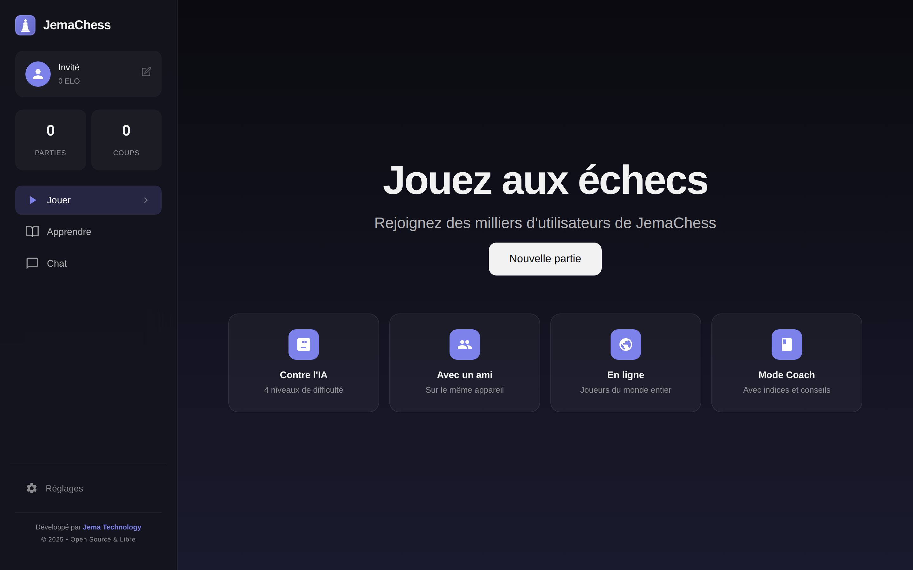
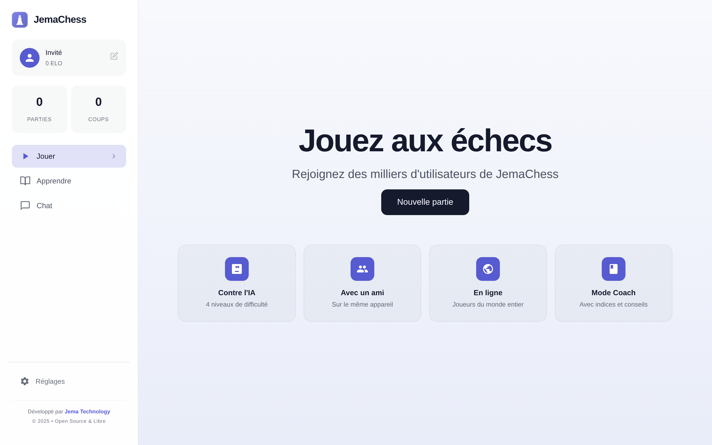
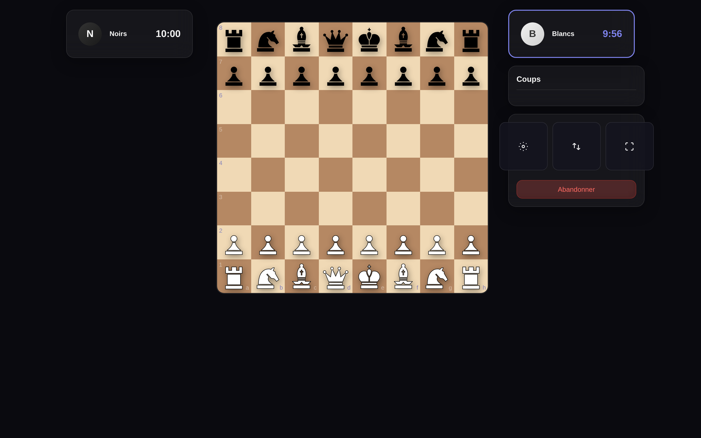
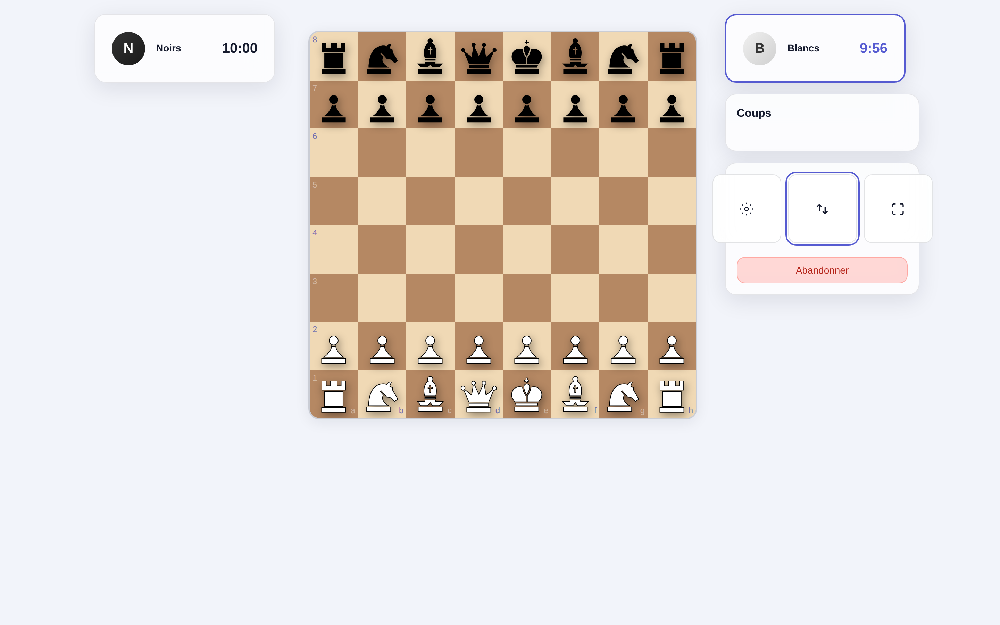
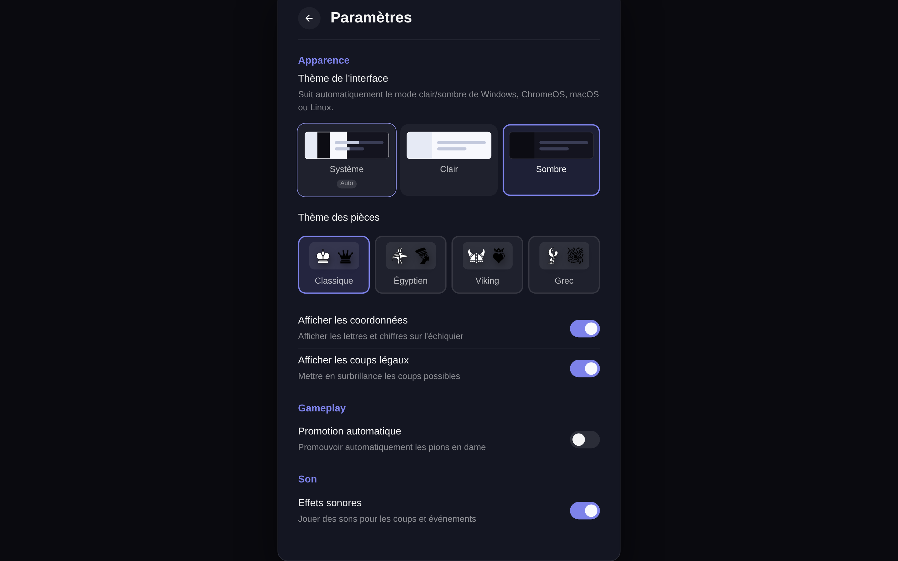
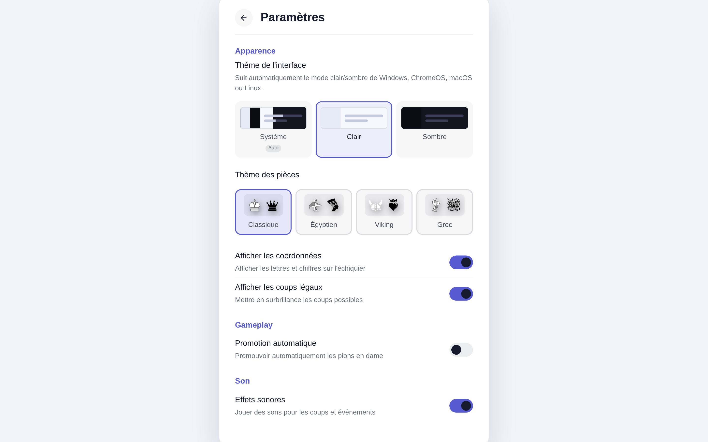
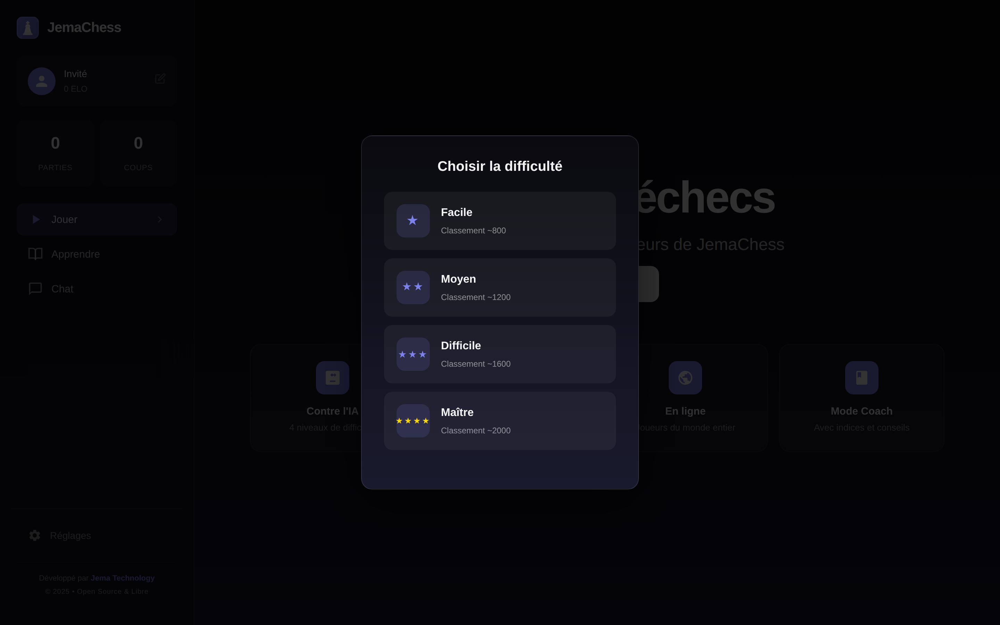
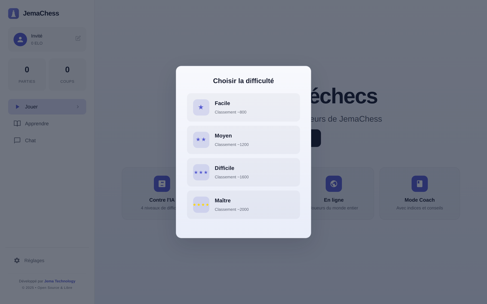
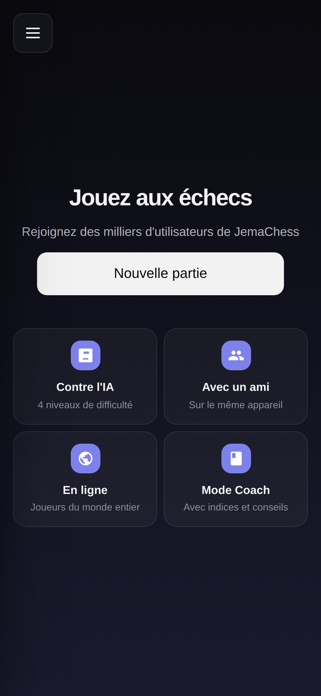
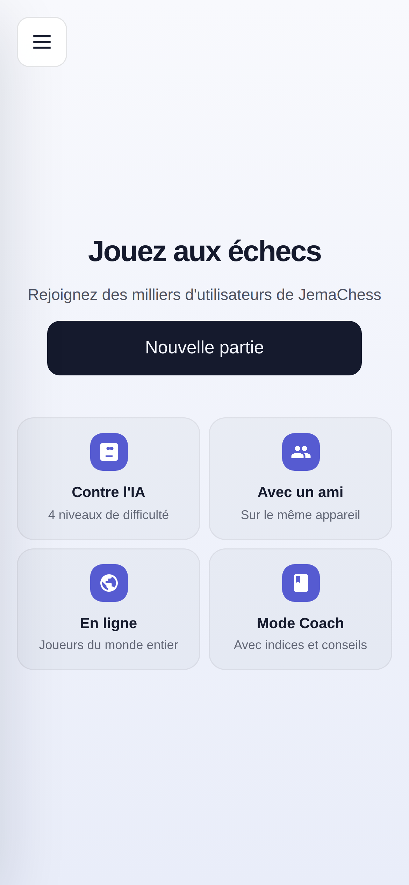

<div align="center">

# ♟️ JemaChess

**Modern, offline-first chess — in your browser.**

Play against an AI, a friend on the same device, or a real opponent online through
peer-to-peer WebRTC. Beautiful glassmorphism UI, light & dark themes, installable PWA.

[](LICENSE)
[](https://www.typescriptlang.org/)
[](https://vitejs.dev/)
[](https://web.dev/progressive-web-apps/)
[](https://webrtc.org/)
[](https://vercel.com/)

[Features](#-features) · [Screenshots](#-screenshots) · [Quick start](#-quick-start) · [Architecture](#-architecture) · [Roadmap](#-roadmap)

</div>

---

## ✨ Why JemaChess?

JemaChess is a **zero-backend** chess app. There is no server to run and no account to
create: online games connect two browsers directly over **WebRTC** (PeerJS + GUN for
signaling), and everything else — AI, board, analysis — runs locally in your browser.
Install it as a PWA and it keeps working **fully offline**.

- 🎯 **No sign-up, no tracking** — your data stays on your device.
- ⚡ **Instant** — Vite build, no framework runtime, pure TypeScript.
- 📱 **Responsive everywhere** — phones, tablets, foldables and desktop.
- 🎨 **Two themes** — light & dark, following your OS automatically.

## 🖼️ Screenshots

### Landing page

| 🌙 Dark | ☀️ Light |
|:---:|:---:|
|  |  |

### Game board

| 🌙 Dark | ☀️ Light |
|:---:|:---:|
|  |  |

### Settings

| 🌙 Dark | ☀️ Light |
|:---:|:---:|
|  |  |

<details>
<summary>🎚️ Difficulty selector</summary>

| 🌙 Dark | ☀️ Light |
|:---:|:---:|
|  |  |

</details>

<details>
<summary>📱 Mobile (portrait)</summary>

| 🌙 Dark | ☀️ Light |
|:---:|:---:|
|  |  |

</details>

## 🚀 Features

| | Feature | Description |
|---|---|---|
| 🤖 | **Play vs AI** | 4 difficulty levels — Facile (~800), Moyen (~1200), Difficile (~1600), Maître (~2000). |
| 👥 | **Play with a friend** | Two players, one device (pass & play). |
| 🌐 | **Play online (P2P)** | Serverless peer-to-peer matches over WebRTC, with room codes. |
| 🧠 | **Coach mode** | Hints and move suggestions to help you improve. |
| 🔍 | **Analysis panel** | Evaluate positions and review the engine's view. |
| 📜 | **Game review** | Replay a finished game move by move. |
| ♟️ | **Piece themes** | Classic, Viking, Egyptian and Greek piece sets. |
| 🎨 | **UI themes** | System / Light / Dark, synced with your OS. |
| ⏱️ | **Chess clocks** | Built-in timers and configurable time controls. |
| 🔊 | **Sound effects** | Procedurally generated sounds — no audio assets shipped. |
| 💬 | **In-game chat** | Chat with your opponent during online games. |
| 📚 | **Tutorial** | Learn the rules and the basics in-app. |
| 🏅 | **ELO & stats** | Local rating and game/coup counters. |
| 📴 | **Offline-first (PWA)** | Installable, works with no connection. |
| 📱 | **Fully responsive** | Tuned for phones, tablets, foldables and desktop. |
| 🔒 | **Hardened** | Input sanitization, strict CSP and security headers. |

## 🧰 Tech stack

| Layer | Technology |
|---|---|
| Language | TypeScript |
| Build | Vite + `vite-plugin-pwa` (Workbox) |
| Chess engine & AI | Custom TypeScript engine (`src/engine`) |
| Online play | WebRTC via **PeerJS**, signaling/discovery with **GUN** |
| State | Lightweight custom store (`src/store`) |
| UI | Hand-written DOM components + CSS (glassmorphism), **no UI framework** |
| Hosting | Vercel |

## 🏗️ Architecture

```
src/
├── engine/        # Board, moves, rules, evaluation, AI
├── network/       # PeerJS connections, rooms, game sync, message protocol
├── ui/
│   ├── components/  # LandingPage, MainMenu, Board, GameScreen, Lobby, Chat, ...
│   └── styles/      # CSS: variables, base, board, layout, responsive-ultimate
├── store/         # App state
├── utils/         # Theme, sound, timer, PWA, responsive, security
└── types/         # Shared types
```

Everything the app needs at runtime is bundled: no backend, no database, no API keys.

## ⚡ Quick start

```bash
# Clone
git clone https://github.com/JemaOS/jemachess.git
cd jemachess

# Install dependencies
npm install

# Start the dev server
npm run dev

# Build for production
npm run build

# Preview the production build
npm run preview
```

Open the URL printed by Vite (usually <http://localhost:5173>).

### Scripts

| Command | Description |
|---|---|
| `npm run dev` | Start the Vite dev server |
| `npm run build` | Type-check and build for production |
| `npm run preview` | Preview the production build |
| `npm run typecheck` | Run `tsc --noEmit` |
| `npm run lint` | Lint the source |
| `npm run test` | Run unit tests (Vitest) |
| `npm run test:e2e` | Run end-to-end tests (Playwright) |

## ☁️ Deployment

The app is a static site: `npm run build` produces a `dist/` folder you can host anywhere
(Netlify, GitHub Pages, Cloudflare Pages, any static host).

This repository is configured for **Vercel** — every push to `main` triggers a deploy via
the workflow in [`.github/workflows/vercel-deploy.yml`](.github/workflows/vercel-deploy.yml).
The included [`vercel.json`](vercel.json) adds a strict **Content-Security-Policy** and a
set of security headers.

## 🗺️ Roadmap

- [ ] Full PGN import / export
- [ ] Cloud game history (optional, opt-in)
- [ ] More piece sets and board textures
- [ ] Engine strength tuning and opening book
- [ ] Spectator mode for online games

## 🤝 Contributing

Contributions, issues and feature requests are welcome — feel free to open an issue or a pull request.

1. Fork the project
2. Create your branch (`git checkout -b feature/awesome`)
3. Commit your changes (`git commit -m 'feat: add awesome feature'`)
4. Push (`git push origin feature/awesome`)
5. Open a Pull Request

## 📄 License

Released under the **MIT License** — see [LICENSE](LICENSE).

---

<div align="center">

**Made with ❤️ by [Jema Technology](https://www.jematechnology.fr/)**

<sub>♟️ JemaChess — échecs modernes, hors-ligne, en pair-à-pair. Aucun serveur, aucun compte : tout se passe dans votre navigateur.</sub>

</div>
